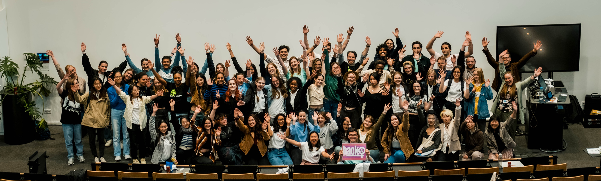

<h2 style="font-size: 1.2em;">🌟 After National Succes the 6th Annual Event will again take place in Amsterdam and Eindhoven 🌟</h2>
The 6th Annual Hack4Her is taking place for the 2nd time at the TU/e Eindhoven and the 6th time at the VU Amsterdam! The Eindhoven event takes place from May 21-23 2027. Open to all students in the Netherlands, we invite you for coding, workshops, lectures, projects, and networking. 
  
Information about the event in Amsterdam, is hosted on [this website](https://hack4her.org/). For the information about the event in Eindhoven, you're in the right place!

## About
Hack4Her is the only female-focused student hackathon in the Netherlands aiming to bridge the gender gap in technology. Our mission revolves around providing women with increased opportunities for hackathon participation and project experience, educating all individuals on the importance of women-centered technology and inclusivity, promoting diversity within the tech community, and facilitating connections among people from various backgrounds.

## Event Highlights
- Open to all **female** students in the Netherlands
- Plenty of opportunities to learn and expand your skillset including coding, workshops and lectures
- **Free** food and drinks provided
- The Challenge Winners can win some **amazing free** prizes
- An awesome networking and community building event!

## Frequently Asked Questions
Check out all FAQ's about the event [here](/contact)!

# News

### Hack4Her received the 4TU Diversity Fund 2026
Hack4Her application won the 4TU.NIRICT fund to lift Hack4Her hackathon to a truly national event from 2026 onwards by bringing it to the TU/e campus and opening the participation and volunteering to 4TU students and staf

[Read more](https://www.linkedin.com/posts/4tu-nirict-netherlands-institute-for-research-on-ict_hack4her-home-activity-7397578349424054272-XI3x?utm_source=share&utm_medium=member_desktop&rcm=ACoAABPzpLQBBNIIWyJKKRvoTUXV2mgcd7r_G54)

#### Jury Report VU Amsterdam Education Awards 2023-2024 Mylène Brown-Coleman co-project lead of Hack4Her

   Vrije Universiteit Amsterdam's news release details of the jury report for the VU Amsterdam Education Awards 2023-2024, where Mylène Brown-Coleman, a bachelor’s student and co-project lead of Hack4Her, was shortlisted for the student talent award for her dedication to inclusivity and safety within the Computer Science department.
   
   [Read more](https://vu.nl/en/education/more-about/jury-report-vu-amsterdam-education-awards-2023-2024)

#### AYA RR Awards 2023: Education Quality, Hack4Her, and Inclusion - Amsterdam Young Academy
   Amsterdam Young Academy announced Dr. Katja Tuma as the recipient of the Societal Impact award at the AYA Recognition & Reward Awards for her organization of the Hack4Her hackathon, which created a safe space for women in a male-dominated field and was commended for its self-organization and impact.
   
   [Read more](https://amsterdamyoungacademy.nl/aya-rr-awards-2023-education-quality-hack4her-and-inclusion/)

#### Great Success for the Hack4Her Event - Network Institute
   The Network Institute reported on the Hack4Her event as a significant initiative highlighting the role of women in technology. The event was noted for its self-organized structure and the social, learning, and skill-practice events that took place.
   
   [Read more](https://networkinstitute.org/2023/06/20/great-success-for-the-hack4her-event/)

#### Hack4Her Shared as Best Practices for Inclusion of Women in Tech - Informatics Europe
Hack4Her entered the Minerva Informatics Equality Award and was shared as part of the Best Practices in Supporting Women in Tech by Informatics Europe.

[Read more](https://www.informatics-europe.org/index.php?option=com_content&view=article&id=321:best-practices&catid=35:minerva-informatics-equality-award)
-->
<!-- Past Events 
## 2022,2023,2024 Events

Over 150 attendees, 50+ projects, and countless moments of innovation over our 2 years active.

"Years of empowering women in tech. See where we've been and what we've achieved." – [Our Journey So Far](/events_archive).-->

<!-- Add past event carousel of images -->

## Sponsors and Partners 2027
For the 2027 TU/e event we're open to collaborate with new partners!
  

If you are interested in learning more about Hack4Her Sponsorship contact us [here](mailto:info.hack4her.tue@gmail.com).

   
## Sponsors and Partners 2026

We want to express our gratitude to the following sponsors for their generous support in making the 2026 TU/e event possible:

  
    
  
  
  
  
  

